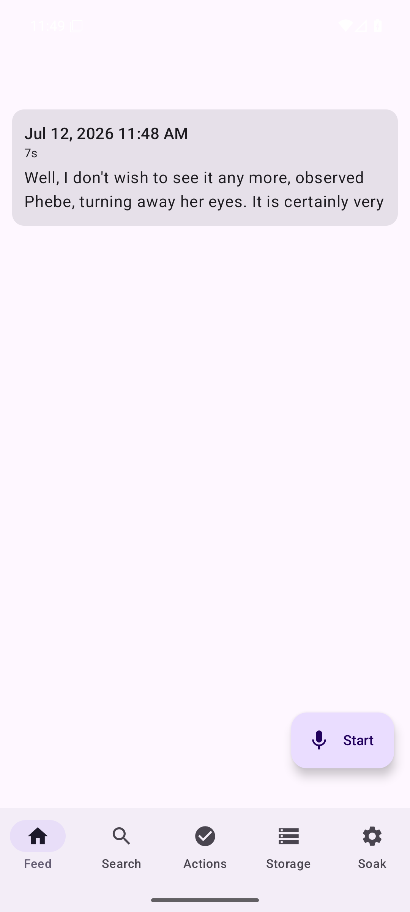
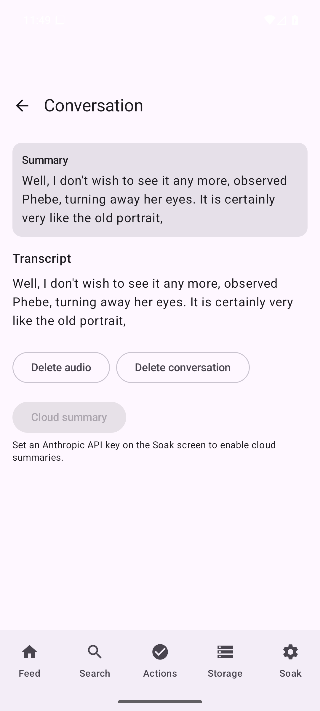

# Emulator end-to-end verification

The full pipeline — APK with native `librecall_core.so` → UniFFI → Rust engine →
Silero VAD → Parakeet ASR → SQLite/FTS5 → Compose UI — verified on a headless
Android emulator, driven entirely by `scripts/e2e-emulator.sh`.

## What the script does

1. Creates (idempotently) an x86_64 AVD `recall_e2e` (`android-36`, `google_apis`,
   pixel_7 profile) with `hw.ramSize=4096` and `disk.dataPartition.size=8G` —
   the int8 Parakeet encoder alone is ~622 MB on disk and RAM-hungry once mapped.
2. Boots it headless (`-no-window -no-audio -gpu swiftshader_indirect
   -no-snapshot -no-boot-anim`) and polls `sys.boot_completed`.
3. Installs `android/app/build/outputs/apk/debug/app-debug.apk` (builds it first
   if missing), grants `RECORD_AUDIO` + `POST_NOTIFICATIONS` via `pm grant`
   *before any launch* (so the runtime-permission dialog never appears), and
   launches the app once so Android creates the external files dir.
4. Pushes the models to the path the app actually probes
   (`RecallRepository.modelsDir` = `getExternalFilesDir("models")`):
   `/sdcard/Android/data/com.recall.app/files/models/silero_vad.onnx` +
   `models/parakeet/{encoder,decoder,joiner}.int8.onnx,tokens.txt` (~630 MB;
   ~50 s over the emulator's virtio transport).
5. Force-stops and relaunches so the repository re-probes the models and
   constructs the engine.
6. Pushes the Parakeet bundle's own `test_wavs/0.wav` (7 s of speech, the same
   wav Task 2's host integration test pinned) to the app's external files dir
   and drives the debug broadcast contract:
   - `com.recall.DEBUG_INGEST --es path <wav>` → chunks the wav through
     `pushAudioBytes` + `finishCapture` (the exact live-capture code path minus
     the mic) and logs `ingest done, conversations=<n>`.
   - `com.recall.DEBUG_DUMP` → logs every conversation's full transcript.
7. Asserts the transcript contains the pinned reference word **"portrait"**.
8. Screenshots the Feed and Detail screens into `docs/img/`.

Run it: `scripts/e2e-emulator.sh` (add `--keep` to leave the emulator running).
The AVD definition is always left in place for reuse; only the emulator process
is killed on exit.

## Results (2026-07-12, clean scripted run from a deleted AVD)

Host: Linux x86_64, 12 cores, KVM. Emulator ABI: x86_64 (the APK carries
x86_64 + arm64-v8a native libs). Boot to `sys.boot_completed=1`: ~80 s.
Model push: ~50 s (652 MB encoder at ~13 MB/s).

- **Ingest of the 7 s test wav: 23.2 s wall clock** from broadcast receipt to
  `ingest done` — that includes engine construction on first use (SQLite open,
  Silero + all three Parakeet ONNX sessions loading ~630 MB of models from
  cold) *and* the VAD → segmentation → Parakeet decode → Opus encode → store
  pipeline. Same-session manual repeats of the identical ingest earlier in the
  day took 5–7 s (RTF ≈ 0.7–1.0). This is a swiftshader x86_64 VM — the phone
  (real arm64 silicon) is expected to be far faster (research saw RTF ≈ 0.09
  on a 2019 Galaxy S10; measure per `docs/M0-runbook.md` Part B).

Logcat evidence (the debug-contract lines, verbatim, from the clean run):

```
07-12 11:48:32.931 I/RecallDebug( 4460): received com.recall.DEBUG_INGEST
07-12 11:48:56.113 I/RecallDebug( 4460): ingest done, conversations=1
07-12 11:48:56.815 I/RecallDebug( 4460): received com.recall.DEBUG_DUMP
07-12 11:48:56.896 I/RecallDebug( 4460): conv id=1 dur=7s transcript=Well, I don't wish to see it any more, observed Phebe, turning away her eyes. It is certainly very like the old portrait,
07-12 11:48:56.896 I/RecallDebug( 4460): dump done
```

The transcript matches the host-side integration test's output for the same wav
word-for-word (Task 2 pinned "portrait" as the stable reference word) — the
on-device ONNX path and the host path agree exactly.

Screenshots:

| Feed | Detail |
|---|---|
|  |  |

Feed shows the ingested conversation (timestamp, 7 s duration, extractive
summary first line). Detail shows the summary card, full transcript,
delete-audio / delete-conversation buttons, and the cloud-summary button
correctly disabled until an Anthropic API key is set on the Soak screen.

## Snags found and fixed while getting to green

1. **Scoped storage blocks `/sdcard/Download`.** The original plan pushed the
   test wav to `/sdcard/Download/test.wav`; the app got
   `EACCES (Permission denied)` opening it — on API 30+ an app cannot open
   arbitrary shared-storage paths with a raw `File`. Fix: push the wav to the
   app's own external files dir (`/sdcard/Android/data/com.recall.app/files/`),
   which the app can always read. The script documents this inline.
2. **Logcat grep format.** `logcat -v time` renders tag lines as
   `I/RecallDebug( <pid>): <msg>` — greps must match `RecallDebug.*<msg>`,
   not `RecallDebug: <msg>`. The first scripted run's detection missed a
   perfectly successful ingest because of this.
3. **Headless SystemUI ANR.** Once, under swiftshader, a "System UI isn't
   responding" dialog stole focus right before the Feed screenshot. The script
   now verifies `mCurrentFocus` is `MainActivity` (retrying with BACK +
   relaunch, up to 5×) before every screenshot/launch-dependent step.
4. **No deep link to Detail.** The app defines no deep-link intent filter, so
   the script reaches the Detail screen by parsing a `uiautomator dump` for the
   conversation row's duration label ("`<N>s`") and tapping its bounds' center
   (fixed-coordinate fallback if the dump fails).
5. **Runtime-permission dialog steals first-launch focus.** On a fresh install,
   `MainActivity` immediately requests `RECORD_AUDIO`/`POST_NOTIFICATIONS`, so
   the grant dialog — not the activity — holds window focus and a focus-based
   launch check spins forever. Fix: `pm grant` both permissions right after
   `adb install`, before the first launch; and verify the first launch by the
   thing it exists to produce (the external files dir), not window focus.
